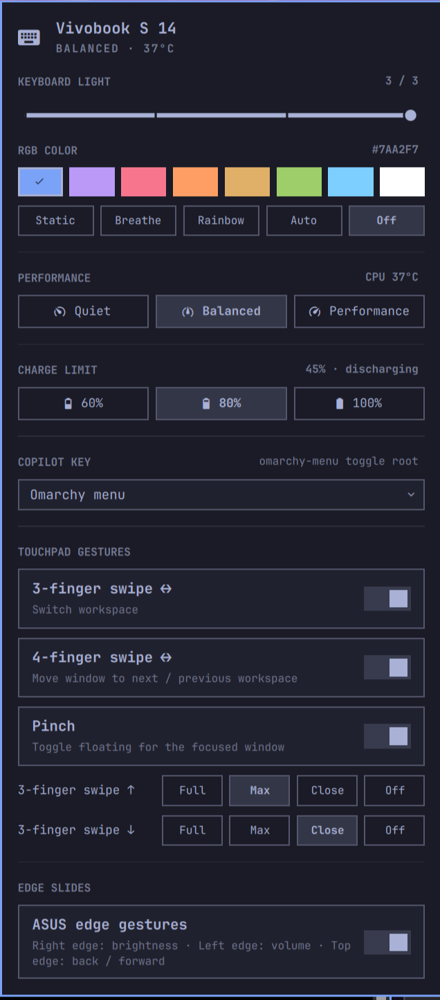

# Vivobook Control for Omarchy

An [Omarchy](https://omarchy.org) shell plugin for the ASUS Vivobook S 14 (S5406SA and
siblings). One bar icon opens a dashboard with the laptop's ASUS-specific controls, and every
control is also reachable from keybindings, the Omarchy menu and the command line.

<p align="center"></p>

| Control | How it works on Linux |
|---|---|
| Keyboard light (0–3) | `asus::kbd_backlight` LED via `brightnessctl` |
| Keyboard RGB color and effects | HID LampArray reports to the ITE5570 controller (`/dev/hidraw*`), driven by a small user daemon (`vivobook-rgbd`) for breathing/rainbow |
| Performance profile | `power-profiles-daemon` through `omarchy-powerprofiles-set` (quiet / balanced / performance) — CPU temperature shown alongside |
| Battery charge limit (60 / 80 / 100 %) | `charge_control_end_threshold` via a tiny root helper, restored at boot and after resume |
| Copilot key | The key emits `Meta+Shift+F23` (keycode 201). Omarchy binds it to its menu by default; the generated Hyprland file takes the key over and runs the action you pick (default: launch your default Omarchy agent) |
| Touchpad gestures | Generated `hl.gesture(...)` rules: 3-finger swipe ↔ workspaces, 3-finger ↑/↓ actions, 4-finger ↔ move window, pinch to float |
| ASUS edge slides | `vivobook-edged` grabs the touchpad, re-emits it through uinput, and turns single-finger slides on the right edge (brightness), left edge (volume) and top edge (back/forward) into actions |

## Install

```bash
omarchy plugin add https://github.com/leandrooricchio/omarchy-vivobook.git --enable
sudo ~/.config/omarchy/plugins/io.github.leandrooricchio.vivobook/setup.sh
```

The plugin works immediately for the keyboard light, performance profile, Copilot key and
Hyprland gestures. `setup.sh` (one time, with sudo) unlocks the rest. It:

- installs `python-evdev`, `brightnessctl`, `wtype`
- installs `/etc/udev/rules.d/70-vivobook.rules` (uaccess ACLs for the RGB hidraw node, `/dev/uinput` and the touchpad — no group changes, no re-login)
- installs `/usr/local/libexec/vivobook-charge` + `/etc/sudoers.d/vivobook` (only that helper, only 60/80/100) and a boot service that restores the saved limit
- installs a `systemd-sleep` hook so RGB and charge limit come back after resume
- enables the user services `vivobook-rgbd` and `vivobook-apply`, links `~/.local/bin/vivobook-ctl`, renders the Hyprland bindings, adds the menu entries and enables the plugin

Remove everything with `sudo .../uninstall.sh`, then `omarchy plugin remove io.github.leandrooricchio.vivobook`.

## Use

- Click the 󰌌 icon in the bar, press `Super+Shift+V`, or run
  `omarchy-shell shell toggle io.github.leandrooricchio.vivobook`.
- Right-click the icon to cycle the keyboard light; scroll on it to step the light up/down.
- Keyboard navigation inside the panel: `j`/`k` move between rows, `h`/`l` move within a row or
  adjust the slider, `Enter` activates, `Esc` closes, `Tab` jumps to the neighbouring bar panel.
- Omarchy menu → Hardware → *Vivobook Control*, *Keyboard RGB Next Color*, *Touchpad Edge Gestures*.

Every change is applied immediately and remembered in `~/.config/omarchy/vivobook/config.json`.
The panel refreshes every 5 s while open and whenever the config changes from outside (keybinding,
menu, CLI).

## The panel, section by section

### Header

Model name (from DMI), the active performance profile and the CPU package temperature
(`coretemp`, falling back to the `TCPU` thermal zone).

### Keyboard light

A 4-step slider (0–3) for the white backlight behind the keys. It writes the
`asus::kbd_backlight` LED through `brightnessctl`, which uses logind so no root is needed. This
is the same LED the `Fn` key and Omarchy's `XF86KbdBrightness*` bindings drive, so the slider and
the hardware keys always agree. Level 0 also blanks the RGB (the LED gates the whole backlight).
The level is restored at login and after resume.

### RGB color

The keyboard is a **single RGB zone** driven by an ITE5570 controller that speaks the HID
LampArray protocol (the same interface Windows Dynamic Lighting uses). There is no sysfs or
`asusctl` support for it on Vivobooks, so the plugin talks to `/dev/hidraw*` directly.

- **Swatches** — eight preset colors (Tokyo Night palette). Clicking one switches to *Static*
  with that color. Any `RRGGBB` works from the CLI: `vivobook-ctl rgb set 00FFAA`.
- **Static** — hold the chosen color.
- **Breathe** — fade the chosen color in and out (`--speed` from the CLI, default 1.0).
- **Rainbow** — cycle the hue through the spectrum.
- **Auto** — hand the keyboard back to the firmware's built-in effect (LampArray *autonomous mode*).
- **Off** — RGB dark (the white backlight level is independent).

Static/Off/Auto are one-shot writes. Breathe and Rainbow are animated by the `vivobook-rgbd`
user service, which also re-applies the state after suspend/resume and keeps working when the
shell is restarted. The section reads *locked · run setup* until the udev rule from `setup.sh`
makes the hidraw node accessible.

### Performance

Three chips mapping to the firmware's platform profiles:

| Chip | `platform_profile` | power-profiles-daemon |
|---|---|---|
| Quiet | `quiet` | `power-saver` |
| Balanced | `balanced` | `balanced` |
| Performance | `performance` | `performance` |

Selection goes through `omarchy-powerprofiles-set`, so Omarchy's separate AC / battery memory
stays authoritative and its own battery-aware switching keeps working. This is the same control as
the profile row in Omarchy's battery panel; it is repeated here because it is the only knob that
affects fan behaviour on this model (there is no fan curve or PWM exposed, so the plugin does not
show or touch the fan).

### Charge limit

Caps charging at **60 %**, **80 %** or **100 %** via `charge_control_end_threshold` (ASUS only
exposes an end threshold, not a start one). Writing it requires root, so `setup.sh` installs a
tiny helper (`/usr/local/libexec/vivobook-charge`) allowed via a one-line sudoers entry; it
accepts nothing but those three values. The chosen limit is saved to `/etc/vivobook/charge-limit`
and restored by a boot service and by the resume hook. The header shows the current charge and
whether the battery is charging or discharging.

### Copilot key

The physical Copilot key sends `Meta+Shift+F23` (keycode 201). Omarchy binds that combination to
its menu by default; the generated Hyprland file unbinds it and binds `vivobook-ctl copilot run`,
which executes whatever the dropdown says:

| Preset | Runs |
|---|---|
| Default agent (picker if none set) | `omarchy-agent --pick` — your default coding agent in a terminal, or Omarchy's agent picker if none is configured (same as `Super+Shift+Ctrl+A`) |
| Default agent (never show picker) | `omarchy-agent` — same, but does nothing if no default agent is set |
| Vivobook dashboard | opens/closes this panel |
| Omarchy menu | `omarchy-menu toggle root` (Omarchy's stock behaviour) |
| Custom command | any shell command, typed in the field that appears below (Enter to save) |

Because the bind calls `vivobook-ctl` at press time, changing the preset needs no reload.

### Touchpad gestures

Native Hyprland multi-finger gestures, rendered into
`~/.local/state/omarchy/toggles/hypr/vivobook.lua` (a directory Omarchy sources on every
`hyprctl reload`, so your `~/.config/hypr` files are never edited). Each toggle regenerates the
file and reloads Hyprland.

| Row | Gesture | Action |
|---|---|---|
| 3-finger swipe ↔ | three fingers left/right | switch workspace (with Hyprland's live swipe animation) |
| 4-finger swipe ↔ | four fingers left/right | move the focused window to the next / previous workspace |
| Pinch | three-finger pinch | toggle floating for the focused window |
| 3-finger swipe ↑ / ↓ | three fingers up / down | **Full** (fullscreen), **Max** (maximize, keeps the bar), **Close** the window, or **Off** |

### Edge slides

The ASUS Windows driver turns the touchpad edges into sliders; this recreates it with the
`vivobook-edged` user service:

1. It opens the ELAN touchpad with evdev, grabs it exclusively, and creates a virtual copy
   (`Vivobook Edge Touchpad`) through uinput. Every event is forwarded to the copy, so Hyprland
   and libinput keep a completely normal touchpad (taps, scrolling, palm rejection, clicks).
2. When exactly **one** finger lands inside an edge zone (default 4 % of the pad; the bottom
   15 % is excluded so clickpad clicks in the corners still work) the daemon holds the events
   for up to 150 ms. If the finger slides along the edge far enough it becomes a gesture and the
   touch is swallowed — the pointer does not move. If instead it taps, moves inward, stays still,
   a second finger arrives or the pad is clicked, the held events are replayed and everything
   behaves as usual.
3. Each `stepPx` of travel (default 40 device units) dispatches one action:

| Edge | Slide | Action |
|---|---|---|
| Right | up / down | `omarchy-brightness-display +5%` / `5%-` (Omarchy shows the OSD) |
| Left | up / down | `omarchy-audio-output-volume raise` / `lower` |
| Top | right / left | `XF86Forward` / `XF86Back` via `wtype` (browser and file-manager history) |

Tune it live (the daemon reloads on the fly): `vivobook-ctl edge set zonePct 6`,
`vivobook-ctl edge set stepPx 80`, `vivobook-ctl edge set top none`. Stopping the daemon
releases the touchpad and removes the virtual device. Note that Omarchy's own *touchpad
disable* toggle only disables the physical device by name, so switch edge slides off as well if
you want the pad fully dead.

### Setup card

Shown only while something is still locked. It carries the exact `sudo … setup.sh` command and a
copy button; it disappears once RGB, the charge limit and uinput are accessible.

### Command line

```
vivobook-ctl status --json            # everything the panel shows
vivobook-ctl doctor                   # what is unlocked and how to fix what is not
vivobook-ctl kbd up|down|cycle|set N
vivobook-ctl rgb set RRGGBB | effect static|breathing|rainbow|off | auto | next | info
vivobook-ctl profile set quiet|balanced|performance | cycle
vivobook-ctl charge set 60|80|100 | cycle
vivobook-ctl copilot set agent-pick|agent|dashboard|menu | set custom --command "..." | run
vivobook-ctl gestures set workspace3|move4|pinchFloat on|off | set up3|down3 fullscreen|maximized|close|none
vivobook-ctl edge enable|disable|toggle|status | set zonePct|stepPx|right|left|top <value>
```

Shell IPC (usable from keybindings): `omarchy-shell vivobook kbdUp|kbdDown|kbdCycle|rgbNext|profileCycle|chargeCycle|edgeToggle|toggle`.

### Changing the Copilot key

Pick a preset in the panel, or `vivobook-ctl copilot set custom --command "omarchy-launch-browser"`.
The Hyprland bind always runs `vivobook-ctl copilot run`, so no reload is needed after a change.

### Settings

State lives in `~/.config/omarchy/vivobook/config.json`; the generated Hyprland file is
`~/.local/state/omarchy/toggles/hypr/vivobook.lua` (Omarchy loads that directory on every
reload — nothing under `~/.config/hypr` is touched). `showKbdLevelInBar` is a normal bar-widget
setting in `shell.json`.

## Development

```bash
git clone https://github.com/leandrooricchio/omarchy-vivobook ~/Work/omarchy-vivobook
cd ~/Work/omarchy-vivobook
./dev.sh --watch        # rsync into ~/.config/omarchy/plugins/<id> on every save + validate
omarchy plugin enable io.github.leandrooricchio.vivobook --section right --index 0
qs log -p "$OMARCHY_PATH/shell" --tail 50   # QML errors land here
```

If a QML change does not show up, `omarchy restart shell` (the shell occasionally keeps a
cached component after a syntax error).

## Privilege boundary

Nothing in the plugin runs as root at runtime. `setup.sh` is the only privileged step; the
sudoers entry allows exactly one root helper (`vivobook-charge`) that accepts only `60`, `80`,
`100` or `restore`. The RGB controller, uinput and the touchpad node are made accessible to the
logged-in seat user via udev `uaccess` ACLs.

## Hardware notes

- The RGB controller is `0B05:19B6` (ITE5570) on I2C-HID, exposed as a HID LampArray
  (usage page 0x59). `asusctl` does not support Vivobooks, and the WMI LED only carries the
  0–3 brightness. `vivobook-ctl rgb info` prints the lamp count and report ids it detected.
- The fan on this model exposes no curve or PWM control, so the plugin does not show or touch it.
- The Copilot key needs kernel ≥ 6.14 to be reported as `F23`.

## License

MIT
